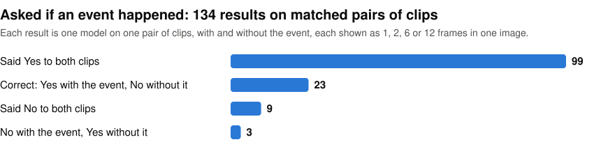

# What can AI see?

I ran six small vision-language models on camera footage, on a Mac Studio M4 Max through Apple's Core AI runtime, to measure what they actually see. Each model (Holo2 4B, LFM2.5-VL 3B and 450M, MiniCPM-V 4.6, North Micro and Qwen3-VL 2B) answers one plain English question about a scene, either once per clip or every 0.4 seconds over a 1.6-second sliding window.

<p align="center">
<picture>
  <source media="(prefers-color-scheme: dark)" srcset="https://raw.githubusercontent.com/john-rocky/what-can-ai-see/main/docs/images/pairs-dark.svg">
  
</picture>
</p>

Asked whether an event happened, they mostly say Yes, whether it happened or not. If you use one as a camera alarm, expect false alerts. Asked about what is in the scene right now, five of the six said Yes in every window of clips where it was raining or a cat was on a bench. No clip here has No as the right answer to those questions, so this does not show they can tell the difference.

All the answers are in `runs/`. To check the first three rows of the table below, run this in a clone. It needs the packages listed after the table, and on a fresh clone it reports one failure:

```sh
python3 tools/verify_claims.py
```

## The short version

| Test | Result |
|---|---|
| Ask a small model "did X happen?" | It nearly always says Yes. Recall is 1.00 in 98 of 136 combinations of model, event and video encoding, and the false-alarm rate is 1.00 in 78 of the 136 |
| Score it on matched pairs instead | Of 134 results on matched pairs of clips, 23 said Yes only to the event clip and 99 said Yes to both. Most pairs come from different scenes, so the 23 may not be detections |
| LFM2.5-VL 3B, the model with the fewest false alarms, against a 1995 background subtractor | False alarms: 8% for the model, 10% for the subtractor. In the windows after the event, the model alarms on 89% and the subtractor on 56% |
| The same events from a second camera | The ranking changes. LFM2.5-VL 3B's balanced accuracy falls from 0.89 to 0.70, and Holo2 4B's rises from 0.74 to 0.89 |
| Everyday questions on six clips where the right answer is Yes: rain, a cat on a bench, a sign | Five of the six answer Yes in every window. LFM2.5-VL 450M answers No every time. No clip has No as the right answer |
| "Are there more than two people?" (two clips with three people, two with two) | No model is right throughout. MiniCPM-V 4.6 is right in 68 of the 69 windows where it answers, and gives no answer in 41 of 110. North Micro is right in all 56 windows of the two-person clips and wrong in 23 of 54 on the three-person clips. The other four answer Yes in half or more of the windows of at least one two-person clip |
| A 15-second clip of a conveyor where nothing happens | Three of the six models alarm in all 34 windows, which is a rate of 8,152 false alarms per hour each |

I scored the answers against hand-written ground truth, and compared them with background subtraction and an object detector with a hand-written rule.

[`tools/verify_claims.py`](tools/verify_claims.py) recomputes row 3 from the answers and checks rows 1 and 2 against the stored scores in `runs/field-v2/scores.json`. That file covers 136 of the 168 combinations that have answers: it leaves out LFM2.5-VL 450M and North Micro on four of the seven events. The script needs Python with numpy, OpenCV, PyYAML and Pillow, not the Xcode build. On a fresh clone it reports one failure, because one check needs a video clip that is not in this repo.

There are no videos in this repo. `clips/*/meta.yaml` names the source of every clip. `tools/fetch_pexels.py` and `tools/fetch_lerobot.py` can download most of them again, but both rewrite the clip's `meta.yaml`, so restore it with `git checkout` afterwards. `tools/fetch_scene.py` only adds clips that are not in `clips/` yet. `clips/spill-pos` has to be cut by hand from a kantine recording, as its `meta.yaml` says.

## On a phone

On an iPhone 17 Pro, LFM2.5-VL 450M's answers mostly matched the Mac's. Over 27 windows, they shared a median of 93% of their content words. It took 4.68 s per window on the phone, so it can't keep up with a new window every 0.4 s.

## Running it

The runner expects [coreai-kit](https://github.com/john-rocky/coreai-kit) cloned next to this repository, and it downloads each model from that package's catalog on first use.

You need macOS 27, the Xcode 27 beta toolchain (Core AI is not in the release SDK), Python with numpy, OpenCV, PyYAML and Pillow, ffmpeg, and a Pexels API key to download the stock clips. The two iOS apps in this repo need a paired device, because Core AI is not in the Simulator.

```sh
DEVELOPER_DIR=/Applications/Xcode-27.0.0-Beta.5.app/Contents/Developer \
  swift build -c release --package-path runner

python3 tools/fetch_scene.py --genres --all --limit 8   # search Pexels for new clips, skipping the ones in clips/
# the next two commands need clips/spill-pos/clip.mp4, cut by hand (see above)
python3 tools/stream.py --clip clips/spill-pos --window 1.6 --stride 0.4 --panels 4
runner/.build/release/wcas-run --model lfm2.5-vl-3b \
  --tasks runs/stream/spill-pos/tasks.jsonl --out out.jsonl
python3 tools/verify_claims.py                           # check the numbers
```

## Documentation

- [Findings](docs/FINDINGS.md)
- [Notes](docs/notes.md): why the ranking kept changing, and what the models are good for

## Licence

Code and measurements: MIT. The footage is not redistributed here: Pexels clips are free to use but not to re-host, and the [kantine](https://huggingface.co/kantine) recordings on Hugging Face are Apache-2.0 at the source.
